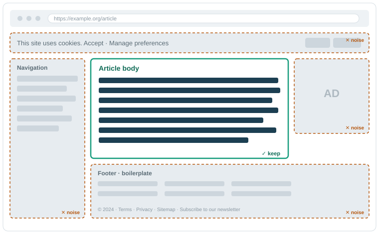
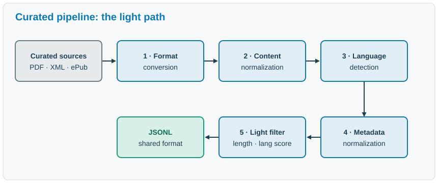

:::::::::::::::::::::::::::::::::::::: questions

-

::::::::::::::::::::::::::::::::::::::::::::::::

::::::::::::::::::::::::::::::::::::: objectives

-

::::::::::::::::::::::::::::::::::::::::::::::::

## The pipeline

How raw text becomes training data. We follow two paths, curated and web, from their very different starting points to a single shared output.

## Not all text is equal

A model learns from whatever text it is shown, so the composition of the data (its sources, its domains, its quality) shapes how the model behaves ([Gao et al. 2020](./reference.html#ref-gao2020pile); [Penedo et al. 2024](./reference.html#ref-penedo2024fineweb)).

Raw text from the internet is uneven:

- clean prose sits next to navigation menus, cookie banners, and boilerplate
- the same page can appear thousands of times
- some text is spam or machine-generated filler

{alt="A diagram of a mock web page, showing the body as the important element, surrounded by various noise elements like navigation, cookie banners, ads, and boilerplate."}

On a typical web page, the genuinely useful prose (the article body) is a small island in a sea of navigation, cookie banners, ads, and boilerplate. The pipeline’s job is to keep the island and discard the rest.

More text is not automatically better text. The job of a data pipeline is to turn a large, messy pile of raw text into a smaller body of training data that is actually worth learning from.

## The fork: curated vs web

That job starts by splitting the raw material by where it came from: two kinds of source need two kinds of handling.

**Curated sources** are collections that already passed through a human curation process before we ever saw them: a book has an editor, an encyclopedia has reviewers, parliamentary proceedings have an official transcriber. That editorial care, someone whose job was to make the text correct and coherent, is what makes them relatively clean, relatively small, and high value per token. They take the *light path*, precisely because most of the quality work was already done upstream.

**Web data** comes from large crawls of the open internet. It is enormous and cheap to obtain, but mostly low value. It takes the *heavy path*: it needs aggressive cleaning before it is usable ([Penedo et al. 2024](./reference.html#ref-penedo2024fineweb)).

The next two sections follow each path from its raw input to the shared JSON record they both produce.

## Curated pipeline

{alt="A diagram of the curated data pipeline, showing the flow from various source formats through conversion, normalization, detection, and filtering to the shared JSONL record."}

The curated path, following Figure 1 of Brandizzi et al. ([2024](./reference.html#ref-brandizzi2024data)): convert each source to plain text, normalize its content, detect its language, normalize its metadata, then apply light filtering. Both paths end in the same shared JSONL record.

The curated path is short because the inputs are already orderly.

### Format conversion and content normalization

Curated sources arrive in many formats: PDF, XML, HTML, ePub. The first step is **format conversion**: extract the plain text[^1] into one common representation, UTF-8 text with the source’s markup and layout discarded. The second is **content normalization**: make the text valid, canonical UTF-8, standardize whitespace and line breaks, and remove stray control characters and conversion artifacts.

This is small and unglamorous work, but it removes a whole class of downstream errors before they can spread.

``` python
import unicodedata
import re

raw = "Café\u00a0\u00a0World\t\ttext   here\r\n\r\n"

def normalize(text):
    text = unicodedata.normalize("NFC", text)   # valid, canonical Unicode
    text = re.sub(r"\s+", " ", text)            # one regex collapses every
                                                # whitespace run: spaces, tabs,
                                                # newlines, even non-breaking spaces
    return text.strip()                         # trim the edges

print(raw)                   # on screen the hidden characters look like spaces
print(repr(raw))             # the real string: non-breaking spaces, tabs, returns
print(repr(normalize(raw)))  # after normalization: ordinary single spaces
```

    Café  World     text   here


    'Café\xa0\xa0World\t\ttext   here\r\n\r\n'
    'Café World text here'

Printed, `raw` already looks clean, yet `repr` exposes the non-breaking spaces, tabs, and carriage returns hiding inside it. The third line shows the same text after `normalize`, where every whitespace run has collapsed to a single ordinary space. Two strings can look identical on screen and still differ character for character, and that invisible mismatch is what later lets one copy of a document slip past deduplication, or makes a search for a phrase miss it. Normalization makes equal-looking text actually equal.

### Language detection, metadata, and light filtering

The Teuken models from the [introduction](./01-introduction.html) span all 24 official EU languages. A multilingual model is trained on a deliberately balanced mix of those languages, so every document first has to be sorted into the one it is written in, something a monolingual (say English-only) pipeline never has to worry about. That means labeling each document with its language and a **confidence score**. That label, with a few other attributes (a unique id, the source URL, the date), is consolidated by **metadata normalization**. Every source describes its documents differently, so this step maps them all onto one schema. After it, every later step reads the same fields no matter where a document came from.

Finally, a *light* filtering pass drops a document that is too short or whose language score is too low to trust. The pass is light because curated inputs are already fairly clean: the goal is to catch obvious problems and otherwise leave the corpus as it is.

The interesting part is where that confidence score comes from. Here is a tiny detector that produces one: the language whose common “stop words” appear most is the guess, and the share of the document those words cover is the confidence. A document we cannot place gets the label `xx`, the same marker the real pipeline uses for non-language content.

``` python
# A toy stop-word language detector. Real pipelines use character n-gram models
# (e.g. fastText); this shows where a language label and its score come from.

STOPWORDS = {
    "en": {"the", "a", "is", "are", "and", "of", "to", "in", "it", "on"},
    "fr": {"le", "la", "les", "un", "une", "et", "de", "est", "dans", "ici"},
    "de": {"der", "die", "das", "und", "ist", "ein", "eine", "zu", "in", "den"},
}

def detect_language(text):
    words = [w.strip(".,!?;:") for w in text.lower().split()]
    hits = {lang: sum(w in sw for w in words) for lang, sw in STOPWORDS.items()}
    best = max(hits, key=hits.get)
    score = hits[best] / len(words) if words else 0.0
    return (best, score) if score > 0 else ("xx", 0.0)

MIN_CHARS      = 20    # too short to be useful
MIN_LANG_SCORE = 0.20  # below this share of known words, we do not trust the label

def keep(text):
    lang, score = detect_language(text)
    return len(text) >= MIN_CHARS and score >= MIN_LANG_SCORE

docs = [
    "The model is trained on a lot of raw text.",      # clear English
    "Le chat dort.",                                   # clear French, but short
    "Le chat est sur le tapis dans la maison.",        # clear French
    "Questo testo non contiene parole molto comuni.",  # a language we did not list
]
```

Real pipelines usually threshold on token counts. We count characters here only to keep the example self-contained.

**Your turn**

First, predict the output. For each document, what language and confidence does `detect_language` return, and does `keep()` keep it?

Then the harder question. `keep()` only sees length and a language score. Sketch a document that would clear *both* thresholds and still be worthless as training data. What does that tell you about what a filter like this can and cannot judge?

**Solution**

The detector’s verdict on each document, computed at render time:

``` python
for d in docs:
    lang, score = detect_language(d)
    print(f"{lang} {score:4.0%}  {'keep' if keep(d) else 'DROP'}  {d}")
```

    en  50%  keep  The model is trained on a lot of raw text.
    fr  33%  DROP  Le chat dort.
    fr  56%  keep  Le chat est sur le tapis dans la maison.
    xx   0%  DROP  Questo testo non contiene parole molto comuni.

Two survive. The English and French sentences are recognized confidently, since about half their words are common function words, so they clear `MIN_LANG_SCORE`. `"Le chat dort."` is dropped by `MIN_CHARS`: at thirteen characters it is too short, even though the detector is fairly sure it is French. The Italian sentence is long and perfectly good text, but our detector knows no Italian stop words, so it scores 0.0, is labeled `xx`, and is dropped. A low score does not mean bad text; it means the pipeline cannot vouch for the label, and data it cannot place by language has nowhere to go in a per-language corpus.

The harder question is the real point. A long, confidently-English block of spam clears both thresholds easily. Cruder cases are caught later by the web path’s quality metrics and blocklists, but the deeper gap, between what a filter can measure and whether the text is any good, is the problem [Part 3](#part-3) takes up.

Our toy detector fails on Italian because it was never given Italian stop words, and that exposes two failure modes real pipelines hit as well. **Low-resource languages are hard to detect:** a detector trained on little text for a language produces low-confidence labels, so genuine documents in that language score poorly and get dropped, exactly as our Italian sentence did. **Similar languages are hard to distinguish:** closely related languages share much of their vocabulary, so a confident label can still be the wrong one (a stop-word detector would struggle to tell Spanish from Portuguese, or Danish from Norwegian). The label and its score are only ever as good as the model behind them.

**Useful tools**

Production pipelines do not hand-roll these steps. Language detection usually runs [fastText’s `lid.176`](https://fasttext.cc/docs/en/language-identification.html) model instead of stop-word counts, and Unicode normalization is left to a library like [`ftfy`](https://github.com/rspeer/python-ftfy), which repairs the mojibake and encoding glitches that a plain whitespace pass misses.

## Web pipeline

{alt="The web data pipeline, which expands the curated pipeline earlier to include additional steps for handling raw web data, such as quality scoring, harmful-content scoring, and deduplication."}

The web path, following Figure 2 of Brandizzi et al. ([2024](./reference.html#ref-brandizzi2024data)): from Common Crawl, normalize aggressively, score for quality and harmful content, detect language, then prefilter, filter, and deduplicate before reaching the same shared JSONL record.

The web path is longer because the input is raw and mostly unusable. The end goal is the same, but it takes many more steps.

### Acquisition

The common web source is [**Common Crawl**](https://commoncrawl.org/), a public crawl of the open web that is republished regularly. Each release is called a *dump*.

A dump can be read in two forms:

- a **WARC** file holds the full raw HTTP response, including the HTML markup
- a **WET** file holds only the plain text already extracted from that HTML

WET is cheaper to process but lower fidelity. Extracting text yourself from WARC keeps more of what matters and gives cleaner results, but it costs more on two fronts: more compute to parse the raw HTML, and more engineering work, because you build the extraction and its filters yourself and have to test that they do what you intend. The trade-off is quality against both compute and effort.

Even a single dump is large, and the full set runs to hundreds of terabytes.

### The processing core

After acquisition, each document passes through a sequence of scoring and detection steps. The point here is what gets *measured*; the actual thresholds come next:

- **normalize**, as in the curated path but more aggressively
- **quality scoring**: a few cheap metrics that estimate how document-like the text is
- **harmful-content scoring**: a separate score for how likely the text is to be toxic or unsafe
- **language detection**: a language label and a confidence score
- **prefilter**: a cheap first pass that discards the clearly unusable

These steps work in tandem: the scoring steps attach a score to each document, and the filter later turns those scores into keep-or-drop decisions. Each is picked up in detail below: the quality metrics and the prefilter under *Filtering*, the harmful-content score under *Harmful content*, and language detection exactly as on the curated path.

### Filtering

Filtering turns each measurement from the processing core into a keep-or-drop decision, cheapest checks first so the expensive ones only ever see documents that already survived. Most quality signals are just *metrics*: a cheap count of something about a document. A filter then compares that metric to a threshold and keeps or drops the document. A few simple signals catch a surprising amount of junk:

- **average words per line**: menus, link lists, and tables are mostly very short lines
- **share of symbols and digits**: code, logs, and gibberish are heavy on non-letters
- **document length**: too little text carries too little signal
- **repeated-line ratio**: navigation and boilerplate repeat the same lines

A prefilter is just a few of these metrics behind thresholds. Here is one made concrete, on three example documents:

``` python
def words_per_line(text):
    lines = [ln for ln in text.splitlines() if ln.strip()]
    return len(text.split()) / len(lines) if lines else 0.0

def symbol_share(text):
    symbols = sum(1 for c in text if not (c.isalpha() or c.isspace()))
    return symbols / len(text) if text else 1.0

def looks_like_prose(text):
    return words_per_line(text) >= 4 and symbol_share(text) <= 0.30

examples = {
    "article":  "Warmer winters are projected for the region.\n"
                "Researchers compared decades of temperature records.",
    "nav menu": "Home\nAbout\nProducts\nContact\nLogin\nHelp",
    "log dump": "[03:11:02] ERR 0x8F retries=3 code={id:9} >>> 11010 0xFF",
}

for name, text in examples.items():
    verdict = "keep" if looks_like_prose(text) else "DROP"
    print(f"{name:9} words/line={words_per_line(text):4.1f}  "
          f"symbols={symbol_share(text):3.0%}  ->  {verdict}")
```

    article   words/line= 6.5  symbols= 2%  ->  keep
    nav menu  words/line= 1.0  symbols= 0%  ->  DROP
    log dump  words/line= 8.0  symbols=50%  ->  DROP

The article keeps; the navigation block fails on words per line, and the log dump fails on symbol share. What to notice is *how* these metrics judge: `symbol_share` reads every character, but it does not understand a single one. It measures the document’s surface statistics rather than what the text means or whether it is any good. That is exactly what makes the check cheap enough to run on hundreds of terabytes, and it is also its blind spot: a fluent, grammatical paragraph of marketing fluff or confident nonsense scores perfectly. Judging *meaning* is a different and much harder problem, and it is the subject of [Part 3](#part-3).

#### Harmful content

Quality is not a single axis, though. The metrics above all ask *is this document-like?* A separate question is *is this safe?* Training data carries the **toxicity and harmful content** of its sources straight into the model’s behavior, so pipelines add a distinct **harmful-content** signal alongside the quality ones, dropping the worst material however clean the document’s shape looks ([Jansen et al. 2022](./reference.html#ref-jansen2022perplexed)).

This check runs *before* language detection ([Figure 3](#fig-web)) because it needs no language label: a **domain blocklist** drops whole unsafe sites before they are fetched, and multilingual **word lists** catch documents heavy with slurs and profanity across languages.

Filtering is where most of the raw volume disappears.

**Useful tools**

Both levels start from public resources rather than a trained model: multilingual profanity lists such as [LDNOOBW](https://github.com/LDNOOBW/List-of-Dirty-Naughty-Obscene-and-Otherwise-Bad-Words) for the word-level check, and a domain blocklist such as the [UT1 blocklist](https://dsi.ut-capitole.fr/blacklists/index_en.php) for the site-level one.

### Deduplication

The web is extremely repetitive. The same article, quote, license notice, or template appears countless times. Training on duplicates wastes compute and can push the model toward memorizing instead of generalizing, so duplicates have to go ([Lee et al. 2022](#ref-lee2022deduplicating)).

Exact duplicates are easy to spot. The hard case is **near-duplicates**: pages that differ only in a date, a header, or an ad. The shared idea is *similarity*: measure how much two documents overlap, and drop one when the overlap is too high. Here is that idea in miniature, scoring documents by the overlap of their word sets (the Jaccard similarity):

``` python
corpus = [
    "The quick brown fox jumps over the lazy dog.",
    "The quick brown fox jumps over the lazy dog.",         # exact duplicate
    "The quick brown fox jumps over the lazy dog. (2024)",  # near-duplicate: a date
    "An entirely different sentence about another topic.",
]

def word_set(text):
    return set(text.lower().replace(".", "").split())

def jaccard(a, b):
    return len(a & b) / len(a | b) if (a | b) else 0.0

sets = [word_set(doc) for doc in corpus]
n = len(corpus)

# Score every pair into a similarity matrix. It is symmetric and its diagonal is
# always 1.0, so the real information lives in the upper triangle (j > i).
sim = [[jaccard(sets[i], sets[j]) for j in range(n)] for i in range(n)]
print("similarity matrix:")
for row in sim:
    print("  " + "  ".join(f"{value:.2f}" for value in row))

# Walk the upper triangle once. Drop document j when it repeats an earlier,
# still-kept document i.
THRESHOLD = 0.5
dropped = set()
for i in range(n):
    if i in dropped:
        continue
    for j in range(i + 1, n):
        if sim[i][j] >= THRESHOLD:
            dropped.add(j)

print("\nverdicts:")
for i, doc in enumerate(corpus):
    print(f"  doc {i}  {'DROP' if i in dropped else 'keep'}  {doc}")
```

    similarity matrix:
      1.00  1.00  0.89  0.00
      1.00  1.00  0.89  0.00
      0.89  0.89  1.00  0.00
      0.00  0.00  0.00  1.00

    verdicts:
      doc 0  keep  The quick brown fox jumps over the lazy dog.
      doc 1  DROP  The quick brown fox jumps over the lazy dog.
      doc 2  DROP  The quick brown fox jumps over the lazy dog. (2024)
      doc 3  keep  An entirely different sentence about another topic.


Figure 4: The same similarity matrix as a heatmap. The bright off-diagonal cells are the duplicate pairs: document 0 against its exact copy (1.00) and its date-stamped near-copy (0.89).

In the upper triangle, document 1 scores 1.00 against document 0 (an exact copy) and document 2 scores high (the same text plus a date), so both are dropped as repeats of document 0; the unrelated document overlaps little with everything and stays. Comparing every pair of documents this way is far too slow at web scale, which is why OpenGPT-X uses **MinHash** with **LSH** (locality-sensitive hashing) ([Leveling et al. 2024](#ref-leveling2024evaluation)) to estimate the same overlap cheaply, without comparing all pairs. The compute cost is still large, and we return to it in [Part 2](#part-2).

**Useful tools**

The near-duplicate method here has mature open implementations: [`datasketch`](https://github.com/ekzhu/datasketch) for MinHash and LSH in Python, [`text-dedup`](https://github.com/ChenghaoMou/text-dedup), which packages the full near-deduplication workflow, and [`deduplicate-text-datasets`](https://github.com/google-research/deduplicate-text-datasets), the suffix-array code released with Lee et al. ([2022](#ref-lee2022deduplicating)).

## Both paths converge

Whatever the source, every surviving document ends in the same shape: one JSON object per line, a format called **JSONL**. Each record carries the cleaned text plus the metadata gathered along the way: source, language, scores, and identifiers.

``` json
{
  "id": "web-2024-30-000123",
  "text": "The cleaned document text, ready for training.",
  "source": "common_crawl",
  "language": "de",
  "language_score": 0.98,
  "quality_score": 0.71,
  "url": "https://example.org/article",
  "timestamp": "2024-07-15"
}
```

On disk each record sits on a single line; it is pretty-printed here only for readability. Fields are illustrative. This shared format is what lets curated and web data be combined downstream: mixing the sources in chosen proportions, versioning the corpus, and tokenizing it for training are all later steps, beyond this document, but each becomes possible only because every source now shares one shape.

Keeping the *scores*, not just the keep-or-drop decision, has a second payoff that matters at scale. The recorded scores are the signals, and a threshold like `MIN_LANG_SCORE = 0.20` is the **filter decision** laid over them. A threshold is a choice, and choices get revisited. The pipeline computes the signals once; the filter decisions stay adjustable afterward.

**Your turn**

Picture a corpus built *without* keeping any of this metadata: just the final text, no source, no scores, no language label. Months later, the model trained on it turns out weak in one language. With only the raw text in hand, how would you even begin to find out why?

Now look back at the JSONL record above. Which fields, had they been kept, would let you answer that, and what would each one tell you?

**One way to reason about it**

- **`language` and `language_score`:** was the language detected at all, and how confident was the detector? A low score points at misclassified or mixed-language text.
- **`quality_score`:** were the surviving documents actually good, or did a loose threshold let filler through?
- **`source`:** is the weak language coming mostly from one source that behaved badly?
- **`id` and `timestamp`:** can you locate and re-pull the exact documents to inspect or re-run them?

The point: without the record, none of these questions are answerable. The metadata is what makes a fault findable.

## Recap

Two very different inputs, curated and web, now share one shape: clean text paired with the metadata that records where it came from and how it was scored. That pairing is the real result of [Part 1](#part-1), and it is two outputs at once, both of which have to hold: the **quality** of the data, and the **traceability** of how it was produced.

So far we have treated each step as a matter of logic: what to keep, what to drop, what to record. [Part 2](#part-2) changes the question. At the true size of these corpora, every one of those steps is also a compute decision, and the traceability we just built is what makes the whole effort survivable.

[^1]: Extraction is lossy and format-specific: a multi-column PDF must be read in the right order rather than straight across, and an HTML or XML file must yield its article body without the surrounding navigation and boilerplate. Getting either wrong corrupts the text before any later step sees it.

::::::::::::::::::::::::::::::::::::: challenge


:::::::::::::::::::::::: solution


:::::::::::::::::::::::::::::::::

::::::::::::::::::::::::::::::::::::::::::::::::


::::::::::::::::::::::::::::::::::::: keypoints

-

::::::::::::::::::::::::::::::::::::::::::::::::
